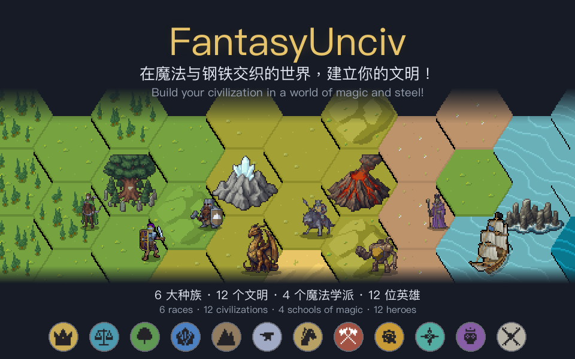

# FantasyUnciv

### 在魔法与钢铁交织的世界，建立你的文明！

[English](README.md) · **版本 2.0**

**FantasyUnciv** 是 Unciv 的完整奇幻规则模组：全新的世界、机制、文明、科技、单位、建筑和奇观！

## 原创奇幻世界观——万方

**万方是一个自然与魔力并存的世界。** 人类、精灵、矮人、兽人、地精与亡灵，6 大种族、12 个文明，共同构成这片世界的历史与纷争。

在这里，带领你的文明走过 **8 大时代**：从早期聚落到城邦与王国，从远洋探索到工业变革，再迈入魔导与新兴时代。从长矛与弩箭，到枪炮与魔导，见证技术与魔法共同推动的文明进程。

## 机制平衡

**让每条胜利路线都值得尝试，让每个文明都有发挥空间。** 我们认真调整机制与数值，尽可能避免某条路线或某个文明占据绝对优势。经过 AI 模拟对局测试，各类胜利的分布已基本均衡，让不同玩法都有争夺胜利的机会。

## 特色城邦

**与城邦结盟，获取独特的加成！** 不同城邦不再只是换个名字，每个城邦有独特的盟约奖励。根据你的发展路线选择盟友，让每一份友谊都拥有不同的战略价值。

## 海上建城

**海洋精灵可以在海上建城！** 训练造礁开拓者，将合适的浅海造礁成岛，建立海上城市，把文明的疆域延伸到海岸之外。

## 召唤英雄

**争夺英雄奇观，招募独一无二的英雄。** 每位英雄都拥有独特的能力与专属晋升，为你的军队带来新的战术选择，在征战中书写属于你的传奇。

## 挑战 BOSS

**挑战强大的 BOSS，赢取独特奖励！** 巨龙巢穴与巨人要塞以特殊城邦的形式盘踞地图，拥有强悍的守军。集结军队，击败强敌，将战利品收入囊中。

## 探索远方

**每一次探索，都可能开启新的故事。** 15种常规遗迹探索结果、4个陆地遗迹事件、5个海洋奇观事件，为远行带来丰富的发现与选择。走进古老遗迹，驶向未知海域，在剧情事件中作出抉择，揭开往事，收获奖励。

## 开始你的征程

1. 在 Unciv 模组管理器中通过本仓库的 GitHub URL 安装，或将仓库内容放入 `mods/FantasyUnciv/`。
2. 创建游戏时，将 **FantasyUnciv** 选为基础规则集。

## 欢迎贡献

欢迎大家贡献游玩反馈、平衡建议、翻译、代码，以及新的文明和故事。你可以通过 Issue 分享发现，也可以通过 Pull Request 参与开发。

欢迎美术作者参与文明徽记、单位、地形、建筑与英雄形象的创作！

## 美术来源

以下图像来自其他作者：

- 常规兵种的单位图：[AbsoluteUnits](https://github.com/letstalkaboutdune/AbsoluteUnits)（letstalkaboutdune，CC BY 4.0）。
- 地形图块：[HexaRealm](https://github.com/yairm210/Unciv)（The Bucketeer / @GeneralWadaling，CC BY-SA 3.0）。
- 部分建筑、科技、政策、晋升、单位、资源、改良与胜利图标：Unciv 原版图标，作者与协议见 [Unciv Credits](https://github.com/yairm210/Unciv/blob/c7e797b8499828bf0fa800668e11901417efc183/docs/Credits.md)。

其余图像由 AI 生成和程序处理。
